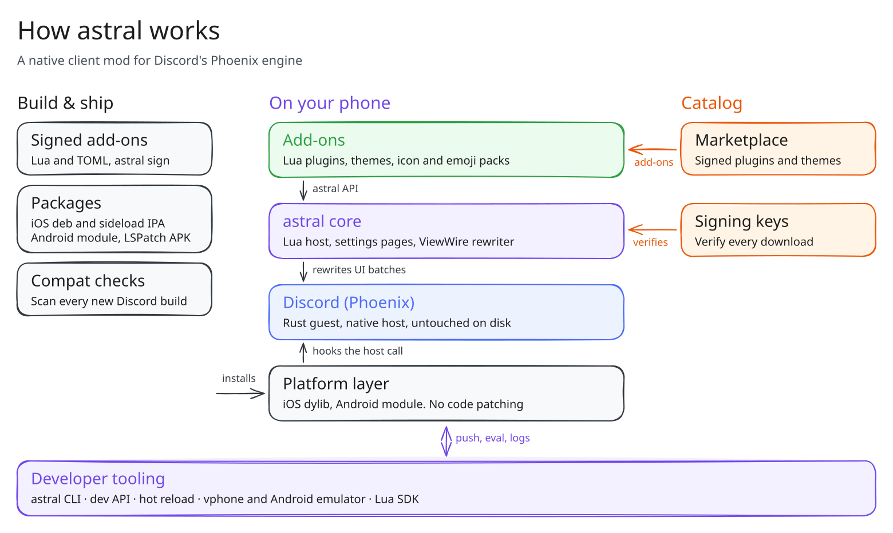

<div align="center">

<!-- TODO: add the logo here once it exists:  -->

<h1>astral</h1>

<b>A native client mod for Discord on iOS and Android.</b>

Lua plugins, themes, icon packs and emoji packs, drawn by Discord's own components.

<br />

[](https://github.com/astral-app/astral/stargazers)
[](packages/addons/plugins/README.md)
[](#installation)

**[Plugins](packages/addons/plugins/README.md)** · [Plugin API](docs/plugins.md) · [Roadmap](docs/roadmap.md)

</div>

<!-- TODO: add a hero screenshot or demo GIF of astral running here. -->

## Contents

- **For Users:** [What Is astral?](#what-is-astral) · [Features](#features) · [Installation](#installation)
- **For Developers:** [Writing Plugins](#writing-plugins) · [Developing astral](#developing-astral) · [Architecture](#architecture)
- **Project:** [Contributing](#contributing) · [Acknowledgements](#acknowledgements) · [Star History](#star-history)

## For Users

### What Is astral?

astral mods Discord's Phoenix engine. It rewrites the UI batches Discord's Rust guest sends to the native host, so everything it adds is a real Discord component.

Jailed and jailbroken installs run the same path. The one piece of code it patches is Phoenix's access gate, so accounts outside Discord's test group can open Phoenix too. Plugins are sandboxed Lua, so a plugin cannot crash Discord.

### Features

| Feature              | Description                                                                         |
| -------------------- | ----------------------------------------------------------------------------------- |
| Plugins              | [40+ bundled Lua plugins](packages/addons/plugins/README.md), signed and verified. |
| Native settings      | An astral category in Discord's Settings.                                           |
| Themes and packs     | Themes, Liquid Glass icons and Fluent emoji.                                        |
| Marketplace          | A signed catalog of plugins and themes.                                             |
| Cross-platform       | iOS and Android share one core.                                                     |

### Installation

There is no release yet. The [Release artifacts](https://github.com/astral-app/astral/actions/workflows/artifacts.yml) workflow builds every package weekly.

| Platform              | Package                                                    |
| --------------------- | ---------------------------------------------------------- |
| iOS, sideloaded       | Sideload IPA. Installs next to stock Discord.              |
| iOS, jailbroken       | `.deb` package.                                            |
| Android, with Xposed  | astral module, scoped to Discord in Vector.                |
| Android, without root | LSPatch-patched Discord APK.                               |

## For Developers

### Writing Plugins

1. Scaffold a plugin: `astral create <id>`.
2. Write it against the [`astral` API](docs/plugins.md).
3. Turn on Developer mode, then hot reload on every save: `DEVICE=<udid> astral dev watch <plugin folder>`.

Outside this repository, `astral sdk install` adds the API types to lua-language-server.

### Developing astral

Requirements: Rust. Theos for iOS, JDK 21 and the Android SDK for Android.

```bash
git submodule update --init
git config core.hooksPath .githooks
cargo astral test
make -C packages/ios package FINALPACKAGE=1
```

`cargo astral` builds the `astral` CLI; run it with no arguments to list every command.

### Architecture

<a href="https://excalidraw.com/#json=i80fBPjWvrkRYb3DnAl7w,NYn7C2i784yPCK2yc9k8Pg">
	<picture>
		<source media="(prefers-color-scheme: dark)" srcset="./docs/assets/architecture-overview-dark.svg" />
		
	</picture>
</a>

1. The platform layer finds Phoenix's host-call entry at runtime and swaps it for astral's own.
2. astral core rewrites each UI batch on its way to the native host, and sends its own.
3. Add-ons reach the core through the sandboxed `astral` Lua API.
4. Plugins and the catalog are signed; astral verifies them against [`keys`](keys).

Click the diagram to open it on Excalidraw.

| Path                                         | Contents                                            |
| -------------------------------------------- | --------------------------------------------------- |
| [`packages/core`](packages/core)             | ViewWire rewriter, Lua host, settings pages.        |
| [`packages/ios`](packages/ios), [`packages/android`](packages/android) | Platform layers.          |
| [`packages/addons`](packages/addons)         | Bundled plugins, themes, icon and emoji packs.      |
| [`packages/catalog`](packages/catalog)       | The default marketplace catalog.                    |
| [`packages/sdk`](packages/sdk)               | Plugin API types for lua-language-server.           |
| [`packages/tools`](packages/tools)           | The `astral` CLI, in Rust.                          |

## Project

### Contributing

1. Run `cargo astral format`, `lint` and `test` before committing.
2. Commit as `type(scope): subject`.
3. Write astral in lowercase.
4. Keep account data, IPAs and decrypted binaries out of the repository.

### Acknowledgements

astral follows [Unbound](https://github.com/marioparaschiv/unbound) closely. [docs/unbound-parity.md](docs/unbound-parity.md) tracks the gap.

<div align="center">

<a href="https://github.com/astral-app/astral/graphs/contributors">
	
</a>

</div>

### Star History

<div align="center">

<a href="https://star-history.com/#astral-app/astral&Date">
	
</a>

</div>
